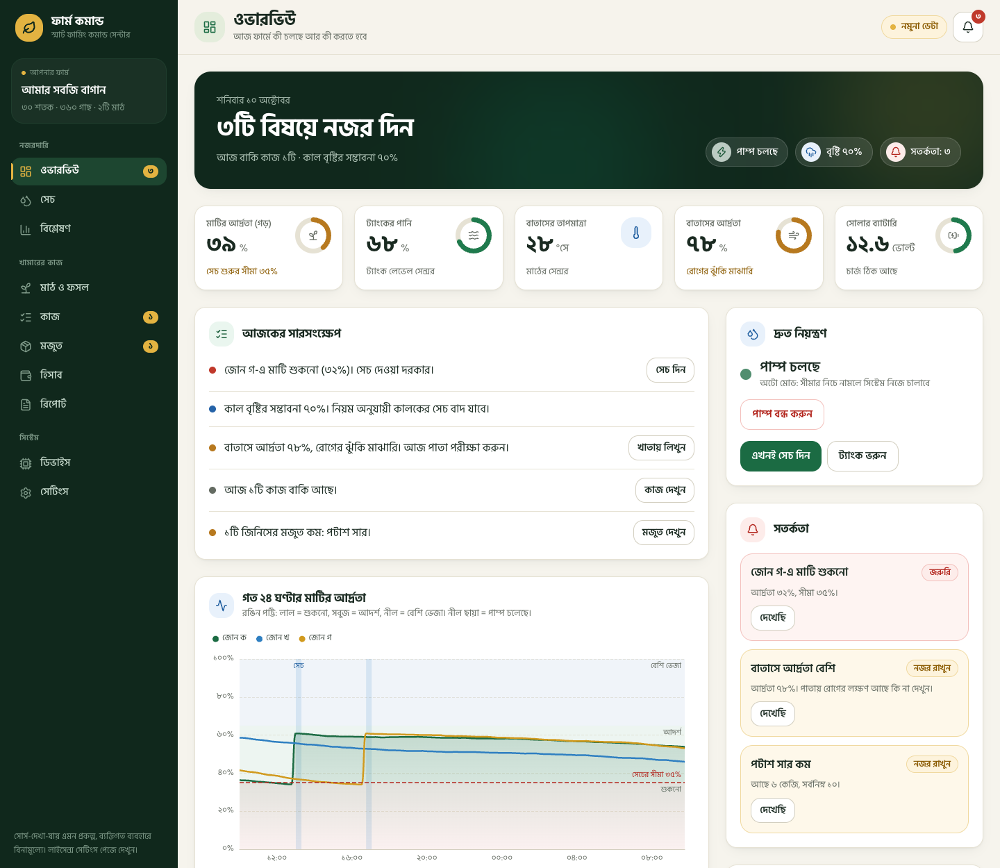
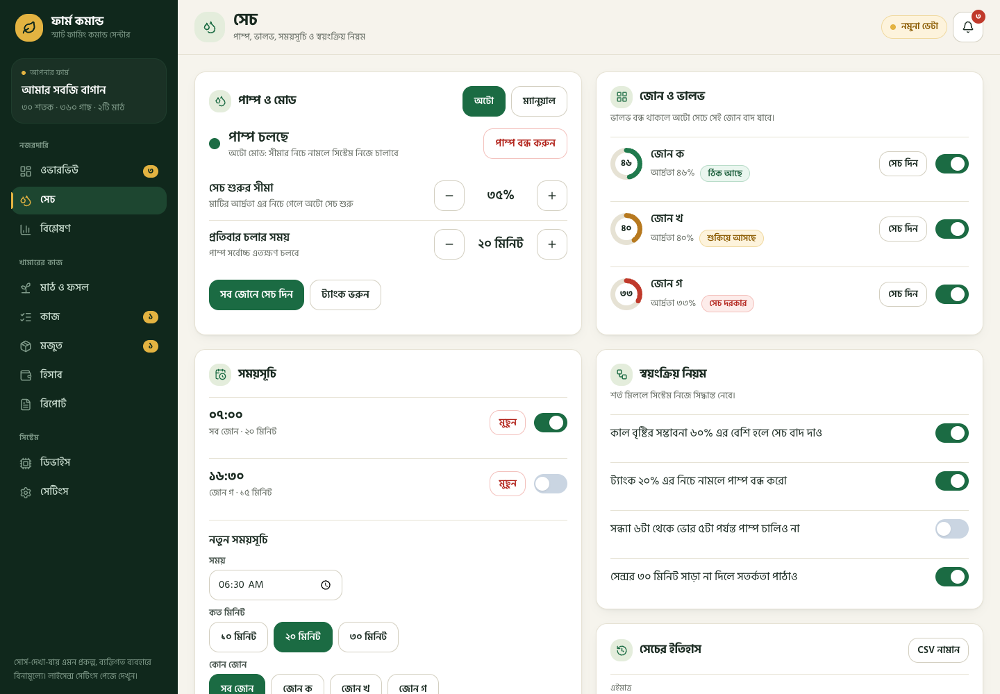
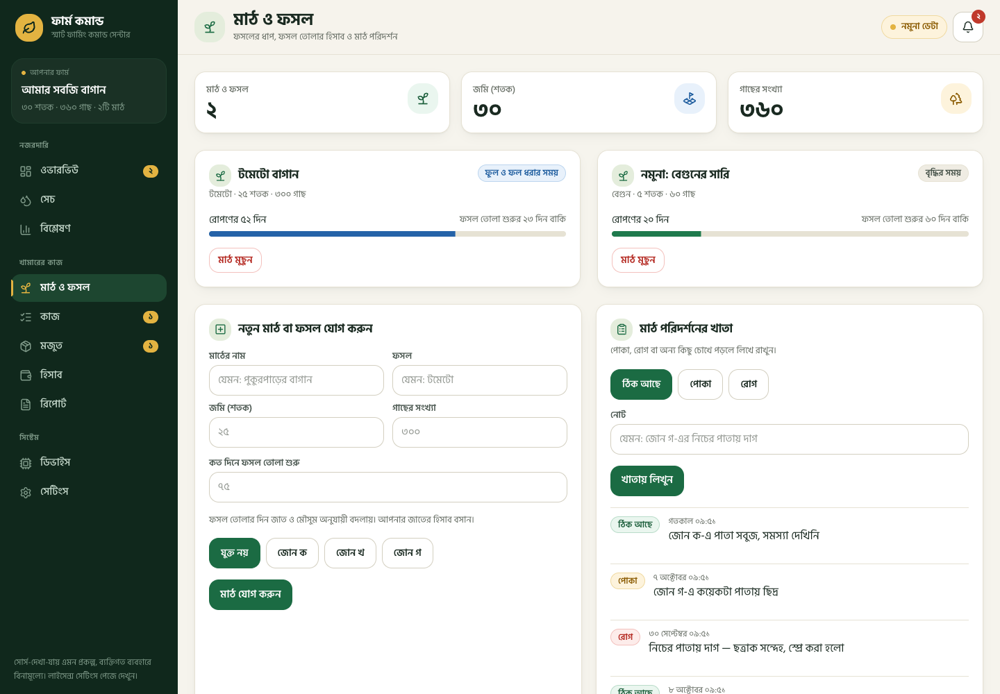
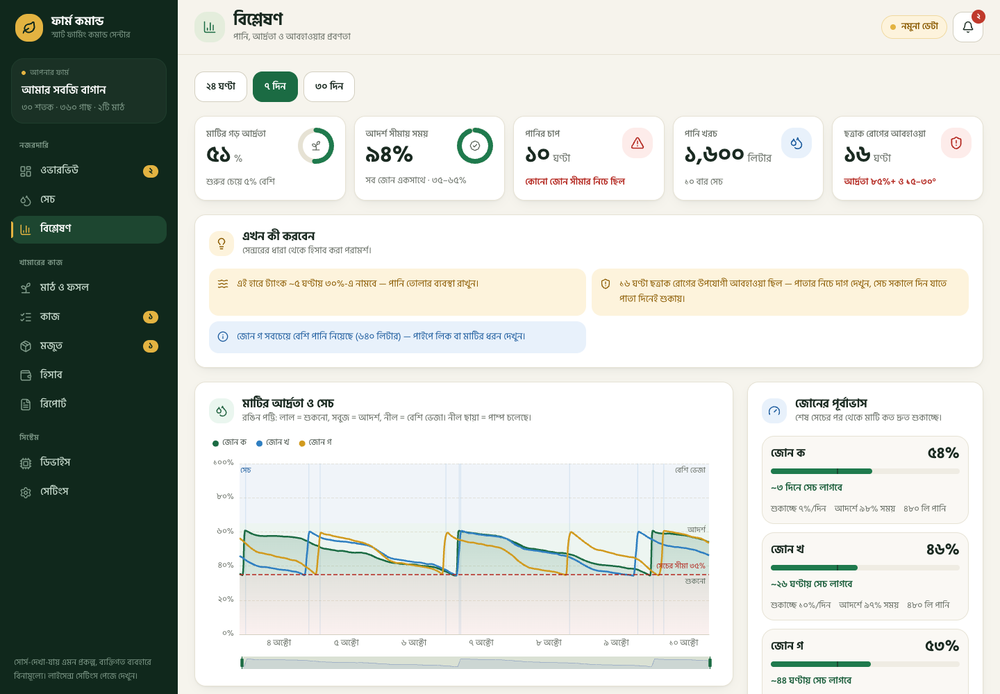
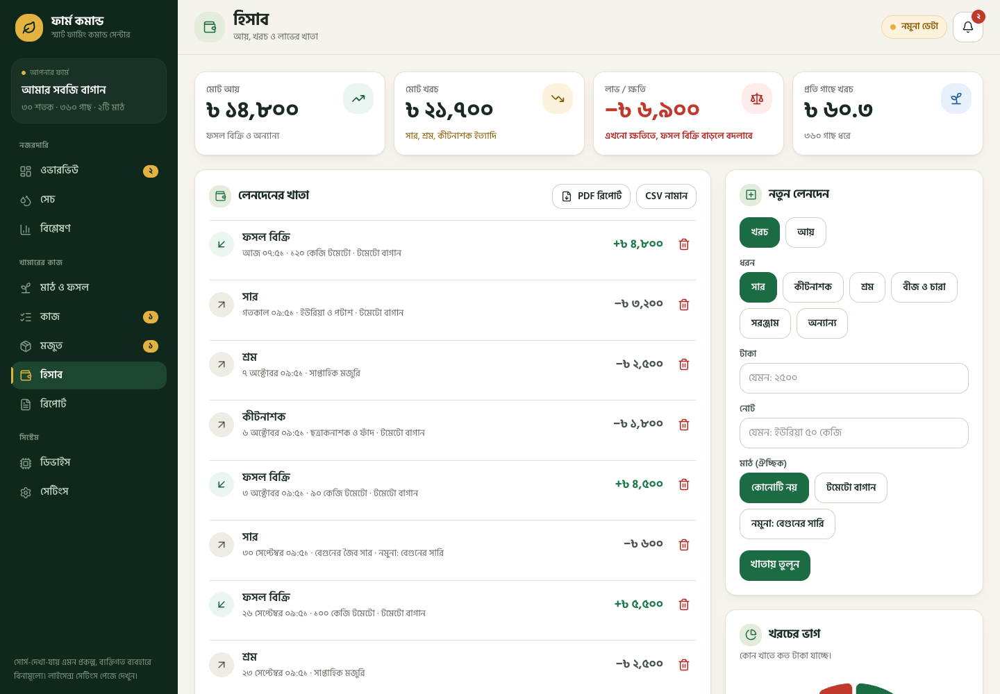

# Farm Command

A full-stack smart-farming system for small farms: irrigation control with safety limits, field
and crop tracking, crop recommendations, tasks, finance, inventory, alerts and weekly reports.
One Go backend, a React dashboard and an Expo mobile app, all in Bangla with an English
translation.

> Bangla README: [README.bn.md](README.bn.md) · Project docs (Bangla): [docs/](docs/README.md)



| Irrigation | Fields & crops |
|---|---|
|  |  |
| **Analytics** | **Finance** |
|  |  |

## What it does

- **Irrigation:** manual and automatic pump control, schedules, rain-skip and tank-guard rules, a
  daily pump-minutes cap, and a server-side rule engine that runs without any client open.
- **Fields and crops:** per-field profit, a 12-crop calendar, next-crop ranking with the reason
  behind each score (season, rotation, water, market price), and dated tasks created when you
  plant a suggestion.
- **Farm work:** tasks with deadlines and repeats, inventory with low-stock shopping list and
  cost booking, income and expense ledger, field observations.
- **PDF reports:** profit and loss (by category and by field), a ranked action plan, lessons learned
  from your numbers and field notes, and a full farm report. Print-to-PDF keeps Bangla text crisp.
- **Alerts and reports:** dry zones, low tank or battery, low stock, offline devices, overdue
  tasks. Delivered by Telegram and SMS (generic HTTP gateway); a weekly digest on Friday morning.
- **Roles:** owner, operator and viewer, enforced on the server (JWT + refresh tokens, optional
  Google sign-in).
- **Offline-first mobile app:** queues task, ledger and note writes while offline and replays
  them safely (client-chosen ids make retries idempotent).
- **Demo mode:** both clients run a built-in simulator with no server at all.

## Architecture

```
backend/    Go 1.25, Gin, GORM, PostgreSQL + TimescaleDB. REST API under /api/v1,
            telemetry ingest, rule engine, alerts, weather, recommendations, reports
dashboard/  React 19, TypeScript, Vite, Tailwind v4, TanStack Query, jotai, ECharts
mobile/     Expo / React Native, same API, offline outbox
docs/       Design docs (Bangla); API reference in docs/09-api-reference.md
```

A few implementation details:

- The pump rules live in a pure function (`backend/internal/engine/step.go`), so every safety
  rule is unit-tested without a database or a clock.
- Each Go test package gets its own Postgres schema (`internal/testutil`), so the database tests
  run in parallel.
- A contract test ties both clients' API calls to the real route table, so a client can't call
  a route that doesn't exist.
- REST conventions are consistent: versioned base path, a single paged envelope, strict status
  codes (201/204/400/401/403/404/409/422/429), documented in
  [docs/09-api-reference.md](docs/09-api-reference.md).

## Run it

Everything in Docker (API and dashboard on one port):

```bash
git clone https://github.com/zulkar29/agri-command-center.git
cd agri-command-center
cp .env.example .env                # optional; set JWT_SECRET for anything beyond a local demo
docker compose up -d --build        # http://localhost:8082
```

Demo accounts, all with password `farm123`: `owner@farm.com`, `baba@farm.com` (operator),
`guest@farm.com` (viewer). These are for local demos only. Before exposing an instance to a network, set `ENV=production` and a long random `JWT_SECRET`, and change the demo accounts, the demo device keys and the database password.

Development:

```bash
docker compose up -d db
cd backend   && go run ./cmd/server           # http://localhost:8000
cd dashboard && npm install && npm run dev    # http://localhost:5173
cd mobile    && npm install && npx expo start
```

Tests:

```bash
cd backend   && go test ./...      # DB tests need TEST_DATABASE_URL (see .env.example)
cd dashboard && npm test
cd mobile    && npm test
```

## Status and limits

Software side is complete; hardware is not built yet.

- No ESP32 firmware or MQTT bridge. Devices (or the simulator) post to `POST /api/v1/telemetry`
  over HTTP. See [docs/05-device-protocol.md](docs/05-device-protocol.md).
- The SMS gateway was tested against a mock server only, not a real provider.
- The crop calendar values (`backend/internal/crops/crops.json`) are starting points and need
  checking by a local agronomist.
- The mobile app was tested through its web export, not on a physical phone.
- Not built: photo attachments, multi-farm accounts, an official market-price source.

Roadmap and open work: [docs/06-roadmap.md](docs/06-roadmap.md).
